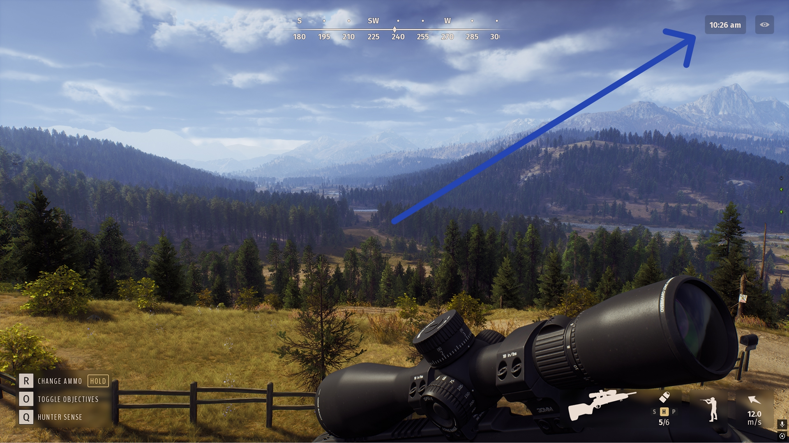
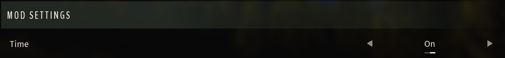

# In-Game Clock Widget

By Mahpella

See the current in-game time in the first-person HUD, with a saved visibility setting and the game's 12/24-hour format.

## Overview

While playing, I kept opening the map just to check the current time. When you follow animal schedules, plan a hunt, or wait for a herd at a drinking zone, you end up doing this quite often.

Eventually, I got tired of constantly switching to the map for something so simple. That is how I came up with In-Game Clock, a small mod that adds a clock showing the current in-game time directly on screen.

## Download & Install

Mod link: [https://mahpella.com/games/way-of-the-hunter/mods/in-game-clock](https://mahpella.com/games/way-of-the-hunter/mods/in-game-clock)  
Repository link: [https://github.com/bymahpella/woth-hud-clock](https://github.com/bymahpella/woth-hud-clock)

**Installation guide**

### Step 1. Create a backup (optional)

If you wish, copy the Saved folder to another location:  
**Win + R → %LOCALAPPDATA%\WayOfTheHunter**

### Step 2. Open the game folder

Close the game. In Steam, browse the local files for Way of the Hunter and open: **WayOfTheHunter\Content\Paks**

### Step 3. Install the mod

Extract the archive and copy all **.pak files into the Paks folder**, replacing older versions if necessary.  
Launch the game and load your save.

Install both `WOTH_HudClock_P.pak` and `WOTH_ModSettings_P.pak` from the current archive. The shared Mod Settings Core version in the prepared archive is **1.0**; keep one current copy when several mods use it.

## How to Use

- Open the game's settings and find the Mod Settings section.
- Use Time to show or hide the clock in the upper-right corner of the HUD.
- Your visibility choice is saved independently of HUD presets.
- The widget follows the game's 12/24-hour time format.

## Feedback

If you find a bug, have suggestions for improving this mod, or have ideas for new mods, I would love to hear from you.

More useful interface and UX mods: [https://bymahpella.com](https://bymahpella.com)

If you would like to support my work →  
Buy Me a Coffee: [https://buymeacoffee.com/mahpella](https://buymeacoffee.com/mahpella)
